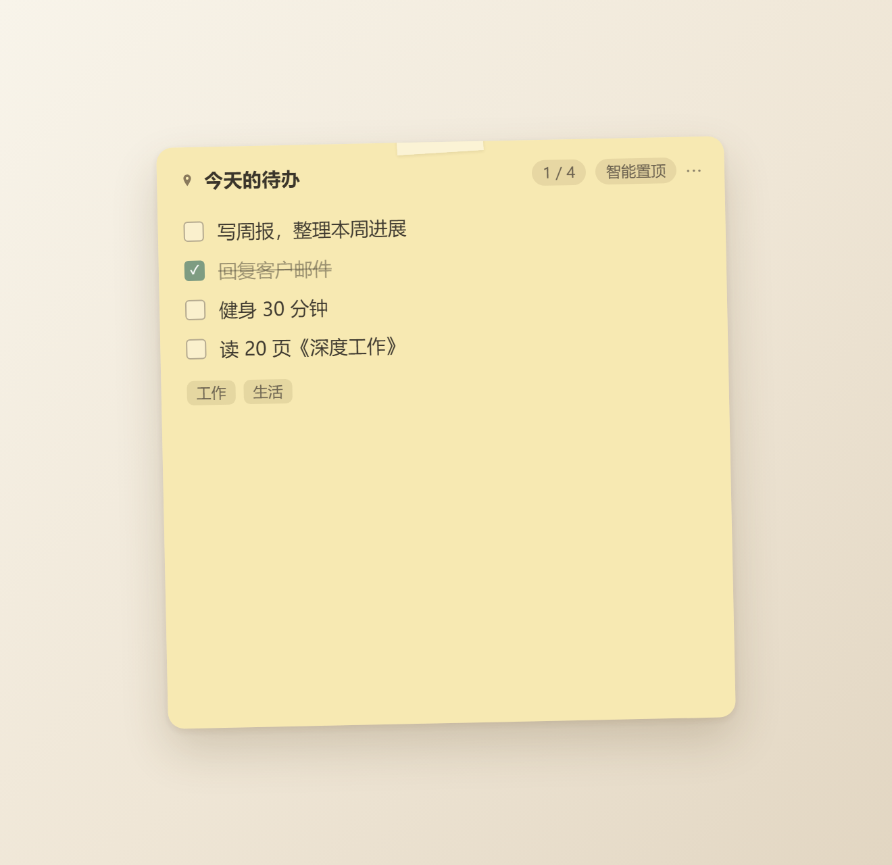

[中文](README.md) | English

# YiyeNote

Windows 10 / 11 · Free & open source · ~52 MB installer · [Download latest](../../releases/latest)



A Windows desktop sticky-note app that behaves like paper on your desk: jot down, tick off, stay out of the way. Everything is stored locally; no account required.

## Features

- **First-run guide**: when no notes exist, a welcome note is created with a sample todo, common shortcuts and a tray hint; deleting it will not bring it back.
- **Paper look**: borderless window with paper texture, shadow and a strip of tape; slightly tilted while reading, straightened when editing or collapsed.
- **Four window levels**: Always on top / Smart top (steps aside for full-screen apps) / Normal / Bottom. Click the pin in the title bar to cycle.
- **Read and edit modes**: read-only by default; click the body to edit, save on blur or Esc; can be locked read-only.
- **Todos live in the text**: no separate list; click a box to tick it, progress is shown in the title bar and tray.
- **Semantic colors and tags**: five colors (Todo / Work / Life / Idea / Other), up to three tags.
- **Search**: global hotkey, matches title, body and tags.
- **Collapse**: shrink to a title strip, click to restore.
- **Tray menu**: all notes and progress, per-note show/hide, grid arrange, corner stacking, launch at login.
- **Local data**: autosave, snapshot on every start, single instance.

## Todo syntax

One item per line; a leading marker defines the state:

```text
- [ ] Write the weekly report
- [x] Send it
-（）Buy milk
（√）Milk bought
```

`[ ]`, `［ ］`, `（）` and `( )` are supported, optionally prefixed with `-`, `*` or `•`. Done markers: `x`, `√`, `✓`, `✔`. Ticking only rewrites that line's marker.

## Shortcuts

| Shortcut | Action |
| --- | --- |
| `Ctrl+Alt+N` | New note |
| `Ctrl+Alt+H` | Show / hide all |
| `Ctrl+Alt+↑` `Ctrl+Alt+↓` | Previous / next note |
| `Ctrl+Alt+F` | Search (`Ctrl+F` works inside a note) |

## Data

- Stored locally and **offline by default**; the LAN API must be enabled manually.
- Autosave after edits; a snapshot is kept in `%APPDATA%\DeskNote\backups` on every start (last 10).
- **Restore**: quit the app, copy the matching `notes-*.json` from `backups` over `notes.json`, then start again.
- Full cleanup: quit, then delete `%APPDATA%\DeskNote`.

## Install

- Requires Windows 10 / 11.
- **Installer**: download `*-setup.exe` from [Releases](../../releases/latest). Per-user install, no admin required; optional desktop shortcut, Start Menu folder, and a "run now" checkbox on the last page.
- **No-install zip**: download `*-portable.zip`, unzip and run `YiyeNote.exe`. Data still lives in `%APPDATA%\DeskNote`, so deleting the program folder will not delete your notes.
- On first run the tray icon appears; right-click it to create a note. Enable launch-at-login from the tray menu.
- Uninstall: Settings → Apps on Windows, or just delete the folder for the portable version. Notes are kept by default.

## FAQ

- **A note disappeared**: check the tray note list; it may be hidden or collapsed. `Ctrl+Alt+H` shows everything.
- **It covers my video**: switch it to Smart top or Bottom.
- **Will I lose content when closing?**: edits are saved shortly after you stop typing, again on exit, and snapshots exist on startup.
- **macOS or mobile?**: Windows only for now.

## Feedback

Questions and suggestions: [open an issue](../../issues).

## Advanced: LAN API (optional)

For scripts or AI assistants: once enabled, devices on the same LAN can read, append and tick notes. Off by default, token required.

**Risk**: plain HTTP, and the token grants full read/write. Enable it only on a trusted LAN and turn it off afterwards. See [API.md](API.md).

## Download

[Download latest](../../releases/latest) · [Star](../../stargazers) · [Issues](../../issues)

## License

Released under the [MIT License](LICENSE). Free to use, modify and distribute; keep the copyright notice.
