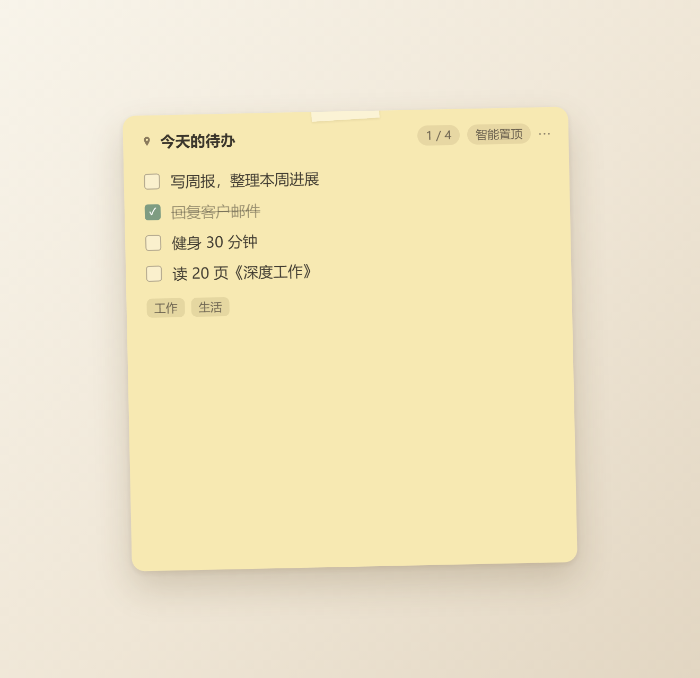

# 一叶便签（YiyeNote）

[中文](README.md) | [English](README.en.md)

Windows 10 / 11 · 免费开源 · 安装包约 52 MB · [下载最新版](../../releases/latest) · [给个 Star](../../stargazers)



Windows 桌面便签：便签像纸片一样贴在桌面上，随手记、随手勾。数据只存在本机，不需要账号。

## 功能

- **首次启动引导**：没有便签时自动创建一张欢迎便签，含示例待办、常用快捷键和托盘位置提示；删除后不再重建。
- **纸质外观**：无边框、纸纹、投影、顶部胶带；阅读时轻微倾斜，编辑或折叠时摆正。
- **四种层级**：置顶 / 智能置顶（全屏应用时自动让位）/ 普通 / 贴底，点标题栏图钉切换。
- **阅读与编辑分开**：默认阅读态，点击正文才开始编辑，失焦或 Esc 自动保存退出；可锁定为只读。
- **正文即待办**：不用另建清单，点击方框勾选，进度显示在标题栏和托盘。
- **颜色与标签**：五种语义色（待办 / 工作 / 生活 / 灵感 / 其他），最多三个标签。
- **搜索**：全局快捷键打开，匹配标题、正文和标签。
- **折叠**：收成一条标题，点开恢复。
- **托盘菜单**：查看所有便签与进度、逐张显隐、网格排列、右上角堆叠、开机自启。
- **本地数据**：自动保存、启动备份，重复启动不会开第二个程序。

## 待办写法

正文里一行一件事，行首标记即状态：

```text
- [ ] 写周报
- [x] 交周报
-（）买牛奶
（√）已买牛奶
```

`[ ]`、`［ ］`、`（）`、`( )` 都支持，前面可带 `-`、`*`、`•`；完成标记支持 `x`、`√`、`✓`、`✔`。勾选只改那一行的标记，不动其他文字。

## 快捷键

| 快捷键 | 功能 |
| --- | --- |
| `Ctrl+Alt+N` | 新建便签 |
| `Ctrl+Alt+H` | 显示 / 隐藏全部 |
| `Ctrl+Alt+↑` `Ctrl+Alt+↓` | 切换上一张 / 下一张 |
| `Ctrl+Alt+F` | 搜索（窗口内 `Ctrl+F` 也可） |

## 数据

- 便签保存在本机，**默认不联网**；局域网接口需要手动开启。
- 修改后自动保存；每次启动在 `%APPDATA%\DeskNote\backups` 留一份快照，保留最近 10 份。
- **找回误删**：退出程序，把 `backups` 里对应时间的 `notes-*.json` 复制成 `notes.json`，再启动即可。
- 想彻底清理：退出程序后删除 `%APPDATA%\DeskNote`。

## 安装

- 系统要求：Windows 10 / 11。
- **安装版**：从 [Releases](../../releases/latest) 下载 `*-setup.exe`，双击按向导安装；按当前用户安装，不需要管理员权限。组件页可选桌面快捷方式，开始菜单会生成「一叶便签」文件夹，最后一页可勾选直接运行。
- **免安装版**：下载 `*-portable.zip`，解压后双击 `YiyeNote.exe` 即可。数据仍保存在 `%APPDATA%\DeskNote`，删除程序目录不会丢便签。
- 首次运行后托盘出现图标，右键即可新建便签；需要开机启动时在托盘菜单开启。
- 卸载：安装版在「设置 → 应用」中卸载；免安装版直接删除程序目录。便签数据保存在 `%APPDATA%\DeskNote`，卸载默认保留。

## 常见问题

- **便签不见了**：托盘菜单里查看列表，可能被隐藏或折叠；`Ctrl+Alt+H` 可全部显示。
- **看视频时还挡着**：切到「智能置顶」或「贴底」。
- **关掉会丢内容吗**：编辑停顿即保存，退出前再存一次，启动还有备份。
- **支持 macOS 或手机吗**：目前仅支持 Windows。

## 反馈

问题和建议欢迎 [提 Issue](../../issues)。

## 进阶：局域网接口（可选）

给脚本或 AI 助手用：开启后，同一局域网内的设备可以读取、追加、勾选便签。默认关闭，需要令牌。

**风险**：明文 HTTP，令牌等同完整读写权限；只建议在可信局域网临时开启，用完关闭。接口说明见 [API.md](API.md)。

## 下载

[下载最新版](../../releases/latest) · [给个 Star](../../stargazers) · [提 Issue](../../issues)

## 许可

本项目基于 [MIT License](LICENSE) 开源，可自由使用、修改和分发，请保留版权声明。
